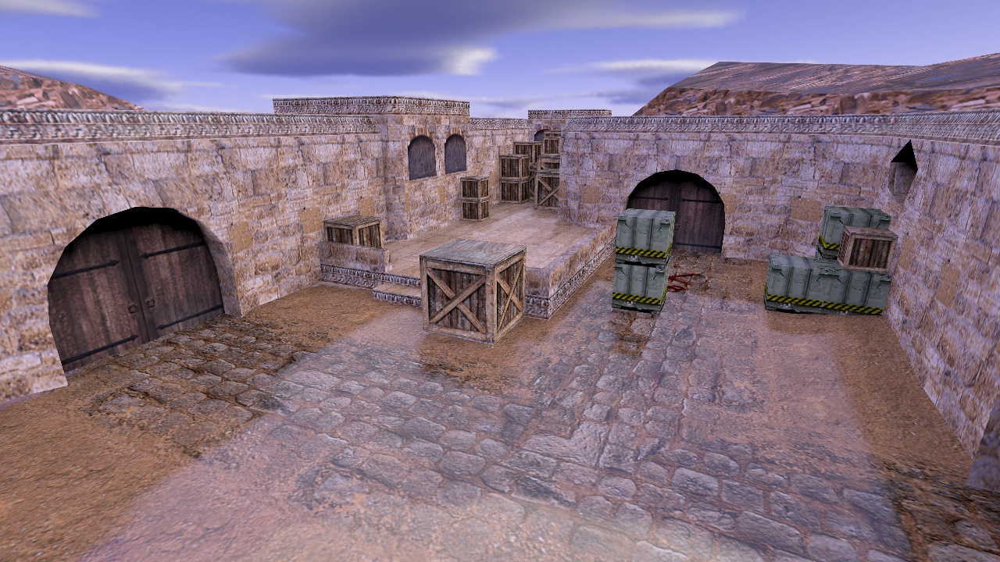

# BASHO
> **Bent Arrayed Sky Hemisphere Occlusion**

made with **unity 6000.3**

## the idea

this is a demo repo for an algorithm i came up with. i was inspired by unigine's ssrtgi, but wanted to see if it's possible to compute bent normals in world space. so the idea is: we render **49 shadow maps** from different directions of the sky hemisphere, one per frame, and then sample **8 of them per pixel**. we compute an average direction from all these samples based on the lambert rule for diffuse and phong for specular.

## why "psx srp"

and yes, the original name is *psx srp*, because initially i wanted to implement some kind of global vertex lighting, but ended up doing all calculations per pixel for the demo. the second reason is that 49 shadow maps take up a lot of gpu memory, so if you use this algorithm you have no choice but to imitate the psx look and compress all your textures and meshes as much as possible to fit into the remaining 1mb of gpu memory.

## dynamic objects

for dynamic objects you should enable the `is dynamic occlusion object` checkbox in the material and add the `sky occlusion dynamic object` component. for dynamic objects we store their 49 object-to-world matrices at the time each shadow map is rendered, to avoid ghosting when moving.
